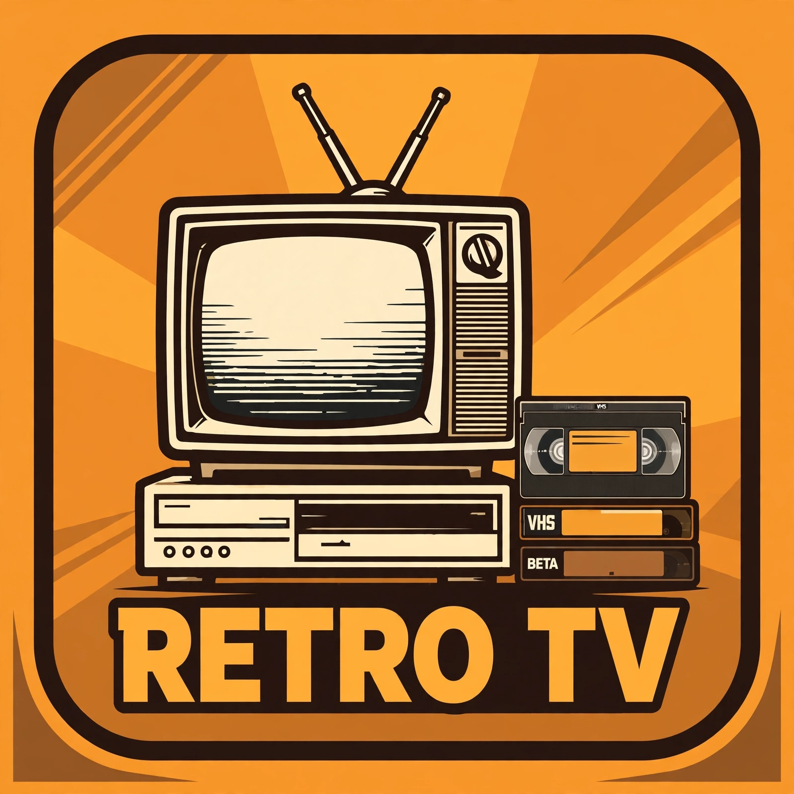

# Retro TV



Retro TV turns the Internet Archive into live retro TV inside Jellyfin —
Saturday-morning cartoons, classic TV, drive-in movies, Prelinger shorts,
vintage ads, soaps, sci-fi theater, and more — as 154 always-on linear
channels with a programme guide, in the spirit of BackWhen TV. It is not
affiliated with BackWhen TV, the Internet Archive, or Jellyfin.

**Free. No accounts, no API keys, no Docker, nothing to pay for.** Video
streams direct from the Internet Archive when you press Play — nothing is
downloaded to your server.

---

## Contents

- [Requirements](#requirements)
- [Install (5 minutes)](#install-5-minutes)
- [First setup — do this once](#first-setup--do-this-once)
- [What you should see](#what-you-should-see)
- [Troubleshooting & FAQ](#troubleshooting--faq)
- [How it works](#how-it-works)
- [The optional on-demand library](#the-optional-on-demand-library)
- [Standalone catalog builder (advanced)](#standalone-catalog-builder-advanced)
- [License & disclaimer](#license--disclaimer)

---

## Requirements

- **Jellyfin 12** (12.4 tested). Any install type — server, Docker, Windows,
  Linux — the plugin runs inside Jellyfin.
- Internet access to `archive.org` (reads only; no uploads, no keys).
- That's it. No Node.js, no extra software, no port forwarding.

---

## Install (5 minutes)

### Option A — from the plugin catalog (easiest)

1. In Jellyfin, go to **Dashboard → Plugins → Repositories → Add**.
2. Repository URL:
   `https://raw.githubusercontent.com/athlon1982/Retro-TV/main/manifest.json`
3. Go back to **Plugins → Catalog**, find **Retro TV**, and install it.
4. **Restart Jellyfin** when it asks you to.
5. Open **Dashboard → Plugins → Retro TV** — that settings page is where
   the rest of this guide happens.

### Option B — manual install from a release zip

1. On the [Releases page](../../releases), download the latest
   `retro-tv_x.y.z.zip` (current release: **0.3.0.3**).
2. In your Jellyfin **plugins** folder, create a folder named `RetroTv`.
3. Extract the zip's contents into that folder (`Jellyfin.Plugin.RetroTv.dll`,
   `meta.json`, `icon.webp`).
4. **Restart Jellyfin**, then open **Dashboard → Plugins → Retro TV**.

To update later, install the new version from the catalog (Option A) or
repeat Option B with the new zip — your settings are kept.

---

## First setup — do this once

The plugin settings page has a **"Getting started — do this first"** box
at the top. It walks you through these four steps. The defaults for
everything else already work — don't change them unless a step below
tells you to.

### Step 1 — Weather zip (the one setting you must change)

The weather channel needs your location. The zip is blank until you enter
your own:

1. Type your zip code in the **Weather zip code** box.
2. Press **Resolve zip**.
3. Check the place name it shows is your town.
4. Press **Save**.

Until you do this, the weather channel has no location and shows nothing.

### Step 2 — Add the tuner and the guide provider (required)

The plugin serves the channels, but Jellyfin only lists them once you
wire the tuner in by hand. The settings page shows you **two links under
"Live TV wiring"** — they are built from *your own server's address*, so
use those links, never anyone else's:

1. **Dashboard → Live TV → TV Tuner → Add → M3U Tuner**
   - Paste the first link from the settings page (it ends in
     `/RetroTv/channels.m3u`).
2. Add an **XMLTV guide provider** for that tuner
   - Paste the second link from the settings page (it ends in
     `/RetroTv/guide.xml`).
3. **Refresh Channels first, then Refresh Guide — in that order.**
   (Live TV → the refresh buttons. Channels first, guide second — the
   guide has nothing to attach to until the channels exist.)

### Step 3 — Apply the theme (one click, fixes the guide)

Jellyfin's built-in guide does not show channel names unless the theme
CSS is applied. On the plugin settings page, pick a theme from the
dropdown and press **Apply this theme**. That writes the theme into
Jellyfin's Branding settings — it keeps any custom CSS you already had
and only replaces a previous Retro TV theme. Themes: **woodgrain-78**
(default), **neon-nights**, **vhs-blue-screen**.

### Step 4 — That's it. No library needed.

Live TV comes from the tuner in Step 2, **not** from a media library.
You do **not** need to create a library called "Retro TV". (If you want
the optional on-demand catalog as well, see
[The optional on-demand library](#the-optional-on-demand-library).)

---

## What you should see

- **154 channels** in Live TV (the lineup is 155 — the Audiobooks channel
  is MP3-only and has no video stream yet, so it isn't served).
- A programme guide up to **96 hours** out.
- A vintage commercial (30–60 seconds) **at most once an hour** per
  channel. This is on by default; turn it off on the plugin settings page
  if you don't want it.
- Channels play in Jellyfin and on the apps (Roku included — the Roku
  renders the guide itself, so the theme CSS in Step 3 doesn't apply
  there, but the channels and guide data work the same).

---

## Troubleshooting & FAQ

### "The guide is blank / has no programmes"

You refreshed the guide before the channels. Do **Refresh Channels**,
then **Refresh Guide**, in that order — and give the guide refresh a few
minutes to finish. If you just installed, the first guide build can take
a while (it covers 96 hours across 154 channels).

### "The guide shows channels but no channel names"

Apply the theme — see [Step 3](#step-3--apply-the-theme-one-click-fixes-the-guide).
Without it, Jellyfin's guide shows blank name cells. Pressing **Apply
this theme** once fixes it. (On Roku the names come from the guide data
itself; the CSS fix is for the web guide.)

### "The weather channel says unavailable / is blank"

The zip wasn't resolved. Go back to
[Step 1](#step-1--weather-zip-the-one-setting-you-must-change):
type your zip, press **Resolve zip**, check the place name, press **Save**.

### "No Retro TV channels at all"

The M3U tuner in Step 2 wasn't added. The plugin alone doesn't create
it — Jellyfin only lists channels from a tuner you add. Re-check Step 2
and make sure you pasted the link from *your own* settings page.

### "I see every channel twice"

You have two tuners serving the same channels — for example the Retro TV
tuner plus an older tuner (or the same M3U added twice). Remove the
duplicate tuner under **Dashboard → Live TV → TV Tuner**.

### "A channel plays but there's no sound / no picture"

Check the **ffmpeg path** on the plugin settings page is blank (it uses
Jellyfin's bundled ffmpeg). Then **restart Jellyfin once**. If one
specific channel never plays while the rest do, that channel's current
programme is a file the Archive is serving slowly — try another channel;
the stream path is the same for all of them.

### "The guide shows programmes from days ago"

Refresh the guide (**Live TV → Refresh Guide**). Stale listings age out
as their time slots pass — the guide only ever grows forward, so an old
entry disappears once its slot is over.

### "Where's the Audiobooks channel?"

It's in the lineup but not served: it's MP3-only and the plugin has no
audio-only stream path yet. The M3U carries the other 154 channels.

### "Can I turn the commercials off?"

Yes — **Old-school commercial breaks** on the plugin settings page.
Default is ON: one 30–60 second vintage spot, at most once an hour per
channel, only at programme boundaries.

### "Do I need to create a library called Retro TV?"

No — not for Live TV. The library is only for the optional on-demand
catalog (see below). If you don't set an output folder, the catalog
build simply doesn't run and Live TV is unaffected.

### "Does it download videos to my server?"

No. Video streams direct from the Internet Archive at play time. The
optional catalog build writes only tiny `.strm` (one-line URL), `.nfo`,
and poster files — no video files.

### "How do I update?"

From the catalog (Option A): **Dashboard → Plugins → Catalog → Retro TV
→ Update**, then restart Jellyfin. Or install the new release zip
(Option B). Settings are kept across updates.

### "How do I uninstall?"

Remove the plugin (**Dashboard → Plugins → Retro TV → Uninstall**),
delete the M3U tuner and its XMLTV provider under
**Dashboard → Live TV**, and restart Jellyfin. If you created the
optional library, delete that library too.

### "What is the user-uploaded tier?"

The catalog has two tiers. **`pd`** is public domain / Creative Commons
material, checked against the Archive's license metadata. **`user-uploaded`**
is user-uploaded recordings of shows that may still be under copyright
(taped-off-air soaps, TV blocks, anime) — included, clearly marked, because
that's what BackWhen-style lineups are famous for. Its rights status is
**not verified**. It's on by default; turn **Include the user-uploaded
tier** off on the settings page if you'd rather not have it, and review
anything you share.

### "I have a question / found a bug"

Open an issue on this repo's **Issues** tab. Say which version you're on
(**Dashboard → Plugins → Retro TV** shows it), what you did, and what you
saw — and check the items above first, they cover nearly everything.

---

## How it works

The plugin builds its channel lineup from a seed catalog of Internet
Archive items (2,982 items across 155 channels). Schedules are
deterministic and shared — everyone tuned in sees the same programme at
the same time. At play time Jellyfin asks the plugin for a stream, the
plugin stitches the Archive file into a live stream with ffmpeg, and
Jellyfin plays it. The guide is generated as XMLTV from the same
schedules. The catalog refreshes additively: new items are added, old
ones are never removed by a refresh.

Nothing is hosted here — no video files live in this repo, and no video
is uploaded anywhere. The repo holds code, docs, and the icon.

---

## The optional on-demand library

If you want the same catalog as a browsable on-demand library (not just
live channels):

1. On the plugin settings page, set an **Output folder** and press **Save**.
2. Add that folder to Jellyfin as a library yourself (Dashboard → Libraries
   → Add Library, mixed content) — the catalog build writes the Retro TV
   icon into it automatically.
3. The daily scheduled catalog build fills it. (Output folder blank =
   the build refuses to run — that's normal for Live TV only.)

Each item is a `.strm` file (one-line Archive URL) plus `.nfo` metadata
and a poster — Jellyfin scans them like any other library.

---

## Standalone catalog builder (advanced)

Don't need the plugin? The repo also has a standalone Node.js builder
(`src/catalog_builder.mjs`) that writes the same catalog to a folder
without installing anything into Jellyfin — point a library at its
output folder yourself. It uses only Node built-ins (no dependencies).

```bash
# 1. Copy the example config and edit it (folders, limits, output path)
cp config.example.json config.local.json

# 2. Build a small pilot set first (~12 items) and check it
node src/catalog_builder.mjs --config config.local.json --pilot

# 3. Look at what it made
ls output/

# 4. In Jellyfin: Dashboard > Libraries > Add Media Library,
#    name it "Retro TV", content type Movies, folder = your output folder.

# 5. When the pilot plays, build the full catalog
node src/catalog_builder.mjs --config config.local.json
```

`config.local.json` (git-ignored — never commit it) controls the build:
library name, output folder, requests per second (be polite to the
Archive; it backs off on 429), MP4 preference, folders (each with a
`tier` of `"pd"` or `"user-uploaded"`, an Archive search query, and a
limit), a curated `pilot` list, and a `prune` list of identifiers to
always exclude. The builder writes `catalog.json` in the output folder
plus a `catalog.prev.json` backup; pruned items stay out on later runs.

**Curation:** after a build, check the catalog and prune anything that
does not play, is wrongly marked, or is junk quality — add its identifier
to `prune` and re-run. To drop the whole user-uploaded tier, delete its
folders from `config` and remove the tier's entries from `catalog.json` —
the `pd` tier is untouched.

Requirements for the builder: Node.js 18+, Jellyfin 12, internet access
to `archive.org`.

### Project layout

```
.
├── README.md               # this file
├── LICENSE                 # MIT — the catalog builder
├── manifest.json           # Jellyfin plugin repository manifest
├── config.example.json     # copy to config.local.json and edit (git-ignored)
├── assets/
│   └── icon.webp           # Retro TV logo (also used as the library image)
├── src/
│   └── catalog_builder.mjs # the builder — Node built-ins only
└── plugin/
    ├── LICENSE             # GPL-3.0 — the plugin
    ├── PLUGIN-DESIGN.md    # full design (catalog, guide, weather, themes)
    ├── BUILD-PLAN.md       # slice plan
    ├── BUILD-0.3.0.3-RECORD.md   # latest build + load-test record
    └── Jellyfin.Plugin.RetroTv/  # C# source — dotnet build via build.sh
```

Generated output (`output/`, `catalog.json`) is git-ignored: the repo
holds code and docs, not the catalog. Your `config.local.json` (paths,
Jellyfin address) is git-ignored too — it never belongs in a public repo.

---

## License & disclaimer

Dual-licensed:

- **The catalog builder (`src/`) is MIT** — see `LICENSE`.
- **The Jellyfin plugin (`plugin/`) is GPL-3.0** — see `plugin/LICENSE`.
  It links Jellyfin's GPLv3 assemblies, so the plugin itself must be GPL.

The Retro TV logo (`assets/icon.webp`) is original artwork for this
project. The videos themselves are not part of this repo: they stream
from the Internet Archive at play time, under whatever license their
Archive metadata states.

This is a personal, household project. You are responsible for what you
include in your catalog — especially the `user-uploaded` tier, whose
rights status is unverified by design. When in doubt, leave it out.
