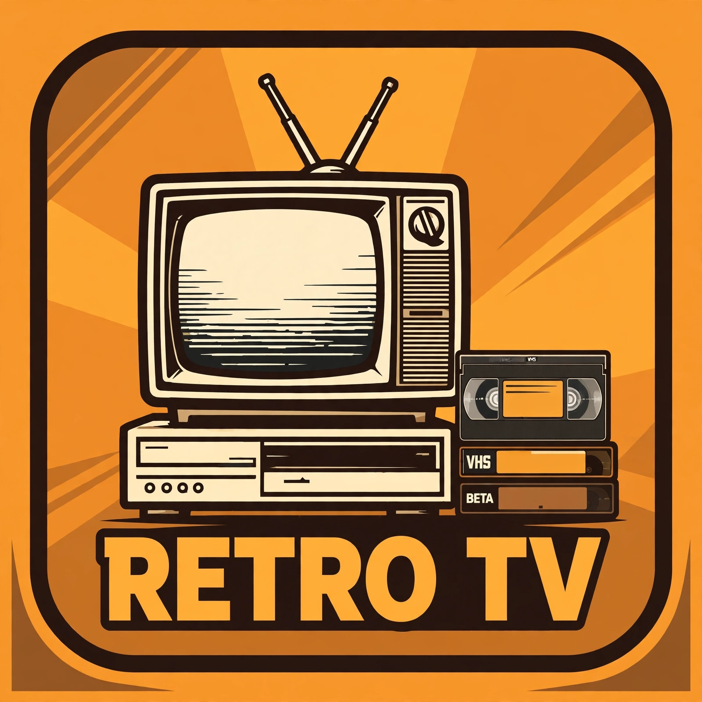

# Retro TV — native Jellyfin plugin



Turns the Internet Archive into a retro-video library **and** live channels
inside Jellyfin — Saturday-morning cartoons, classic TV, drive-in movies,
Prelinger shorts, vintage ads, soaps, and more, with always-on linear
channels, a themeable guide, and a weather channel, in the spirit of
BackWhen TV. Not affiliated with BackWhen TV, the Internet Archive, or
Jellyfin.

**Status: v0.3.0.0 — full lineup live.** Load-tested on a real Jellyfin
12.4.0 server: pilot catalog builds 12/12, guide serves 154 channels
with 96-hour schedules and old-school commercial breaks (one 30–60 s
vintage spot at most once an hour per channel, toggle on the settings
page, default ON), M3U + XMLTV answer, live ffmpeg streams play, weather
channel live from Open-Meteo. See `BUILD-0.3.0.0-RECORD.md` for the full
verification run. Audiobooks is the one channel not served: its items
are MP3s and the plugin has no audio-only stream path yet.

## Install

The easy way — from the plugin repository:

1. Dashboard → Plugins → Repositories → add
   `https://raw.githubusercontent.com/athlon1982/retro-tv/main/manifest.json`
2. Dashboard → Plugins → Catalog → install **Retro TV**, restart Jellyfin.
3. Dashboard → Plugins → Retro TV → settings: set the output folder,
   save, then **Build pilot** and check the folder.
4. Add the output folder to Jellyfin as a Movies library named
   **Retro TV**. It scans like any other movie library.

Manual install: unzip the release `retro-tv_0.3.0.0.zip` into the Jellyfin
**data** plugins folder as `RetroTv/` (Jellyfin 12.4:
`<datadir>/plugins/RetroTv/` — on Windows that is
`F:\JellyfinData\Server\plugins\RetroTv\`; the config-dir path is silently
ignored in 12.4), then restart Jellyfin and follow steps 3–4 above.

## The channel guide (v0.3.0.0)

The guide is a linear-TV lineup built from the same Internet Archive
catalog as the on-demand library:

- **154 channels at launch** (153 from the built-in pools + the
  synthetic weather channel), numbered 1–216 following the live
  sidecar's lineup: kids first, then sitcoms, action, drama, music,
  movies, soaps, home, sports, news, and commercials. Both tiers are
  live — public domain and user-uploaded (rights status not verified,
  clearly marked, never presented as public domain).
- **Shared-clock schedules**: 96 hours, anchored at midnight UTC, so
  tuning in joins the programme already in progress — just like real TV.
  Soaps play oldest episode first. Jellyfin refreshes the guide every
  48 hours, so the 96-hour window always leaves ~48 hours of overlap —
  no gaps even if a refresh runs late.
- **Old-school commercial breaks**: one vintage commercial (30–60 s)
  at most once an hour per channel, between programmes — like BackWhen
  TV. Toggle on the settings page (default ON, server-wide, no restart
  needed). Ad Break and the decade ad channels, Station Break, and
  Audiobooks never get breaks.
- **Themeable guide page** at `/RetroTv/Guide` — three built-in themes:
  Woodgrain '78 (default), Neon Nights, VHS Blue Screen. Switchable from
  the plugin settings; the page reads the active theme from the server.
- **Weather channel** (125) by zip code — Open-Meteo, free, no key.
  Three rotating 5-minute segments: Current Conditions, 7-Day Outlook,
  Hourly Forecast. Default zip is 05773 (Wallingford, VT); change it on
  the settings page.
- **Live streams**: each channel streams as MPEG-TS (H.264 + AAC,
  640×480, 30 fps) stitched live by ffmpeg — NVENC when the server has
  a usable NVIDIA encoder, software libx264 otherwise. Nothing is
  downloaded to disk; video comes straight from the Internet Archive
  at play time.

### Wiring Live TV in Jellyfin

Dashboard → Live TV → TV Tuner → Add → M3U Tuner:

- M3U URL: `http://<your-server>:8096/RetroTv/channels.m3u`
- Then add an XMLTV guide provider with URL:
  `http://<your-server>:8096/RetroTv/guide.xml`

Refresh Channels first, then Refresh Guide, or the guide comes up blank.
The settings page shows both URLs for your server.

### Endpoints (all on your Jellyfin server)

| Route | What it is |
|---|---|
| `/RetroTv/Guide` | Themeable guide page (anonymous) |
| `/RetroTv/Guide/Data` | Guide JSON — channels + 96 h programmes |
| `/RetroTv/channels.m3u` | M3U tuner playlist |
| `/RetroTv/guide.xml` | XMLTV guide data |
| `/RetroTv/Guide/Themes` | Theme list; `?theme=<id>` previews one |
| `/RetroTv/Guide/Weather` | Current weather summary for the guide header |
| `/RetroTv/Guide/Icon` | The Retro TV icon (channel logo) |
| `/RetroTv/Live/<channel-slug>` | Live MPEG-TS stream for a channel |
| `/RetroTv/Status` | Last catalog build (admin) |
| `/RetroTv/Build?pilot=true` | Trigger a catalog build (admin) |

## Settings

- **Output folder** — where the `.strm` / `.nfo` / `poster.jpg` files
  and `catalog.json` land, plus `folder.jpg` (the Retro TV icon, used
  as the library's poster).
- **Live channels** — on/off switch for the whole guide + streams.
- **Old-school commercial breaks** — one vintage spot at most once an
  hour per channel (default ON). The switch is server-wide (the whole
  household) and Jellyfin picks it up at its next guide refresh.
- **Guide theme** — Woodgrain '78 / Neon Nights / VHS Blue Screen.
- **Weather zip code** — resolves to coordinates via Open-Meteo
  geocoding when you save (the page geocodes first, then saves).
- **ffmpeg path** — optional; blank means `ffmpeg` from the PATH.
  NVENC is used automatically when the ffmpeg reports a working
  `h264_nvenc` encoder, otherwise libx264.
- **Weather slate font** — optional; blank auto-detects DejaVu Sans
  (Linux) or Arial (Windows). Without a font the weather channel
  lists in the guide but cannot stream.
- **Catalog folders / pilot list / tiers** — the same JSON the
  standalone Node builder uses (see `../../src/catalog_builder.mjs`).
  Two tiers: `pd` (public domain / CC) and `user-uploaded` (rights
  status not verified — clearly marked, separable; see the root README).

## Build

```bash
# .NET 10 SDK (the build used 10.0.403)
dotnet build -c Release --nologo
```

Then zip `Jellyfin.Plugin.RetroTv.dll` + `meta.json` + `icon.webp`
into `dist/retro-tv_0.3.0.0.zip` by hand and note its MD5 (for the
manifest entry when the release is created). **Do not run `build.sh`
until the 0.3.0.0 release exists on GitHub** — it writes the new
checksum into `../../manifest.json`, which would point Jellyfin at a
release that isn't there yet. Nothing is uploaded or pushed by the
build.

## License

**GPL-3.0** — this plugin links Jellyfin's GPLv3 assemblies
(`Jellyfin.Controller` / `Jellyfin.Model`), so the plugin itself is
GPL-3.0 (see `LICENSE`). The standalone catalog builder in `../../src/`
stays MIT; the repo as a whole is dual-licensed (see `../PLUGIN-DESIGN.md`
§9). The Retro TV logo (`icon.webp`) is original artwork for this project.
